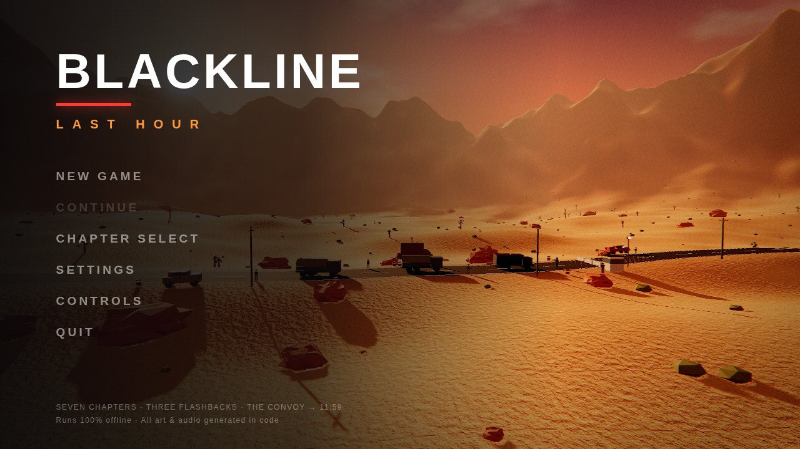
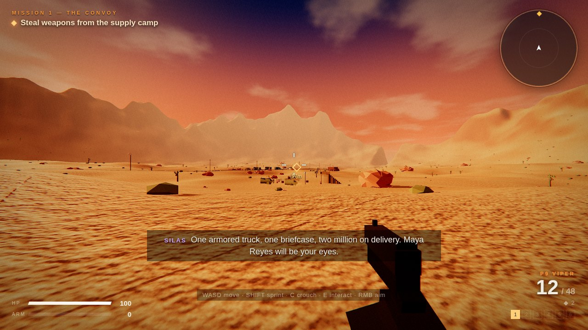
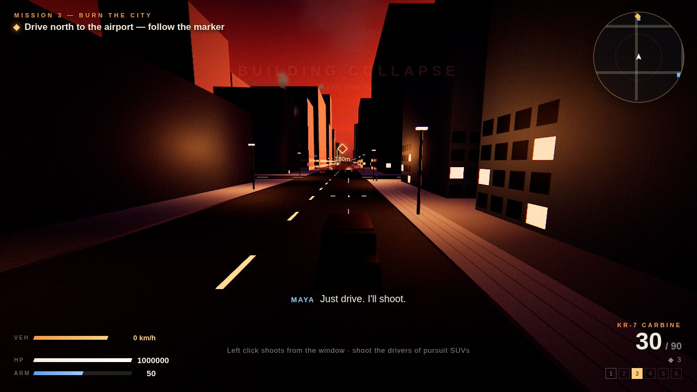
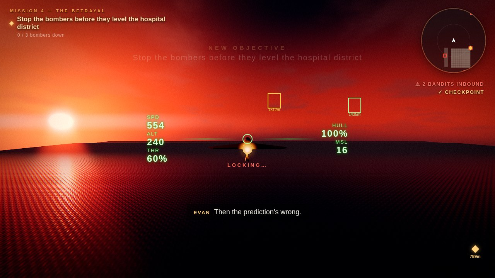
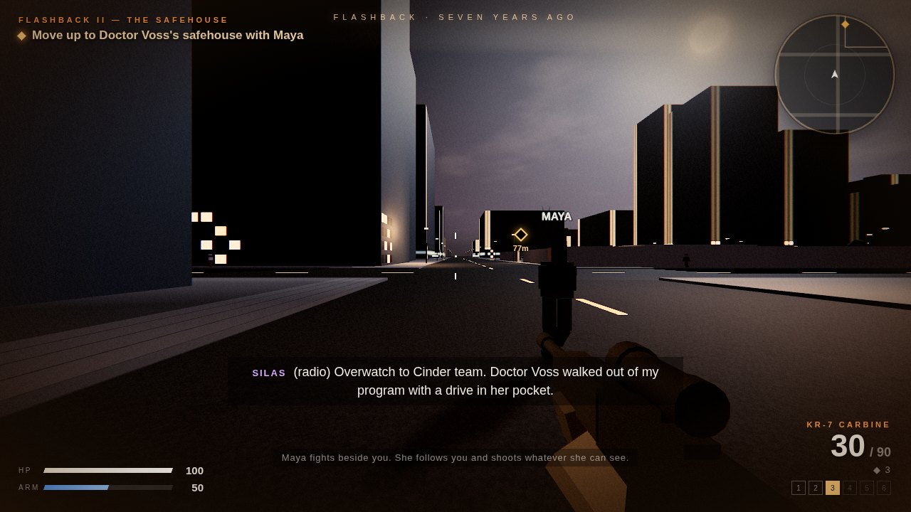
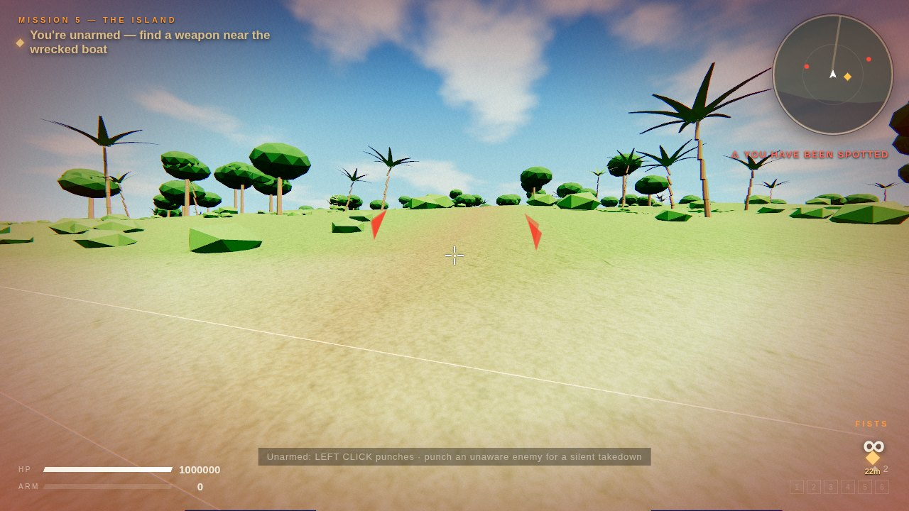
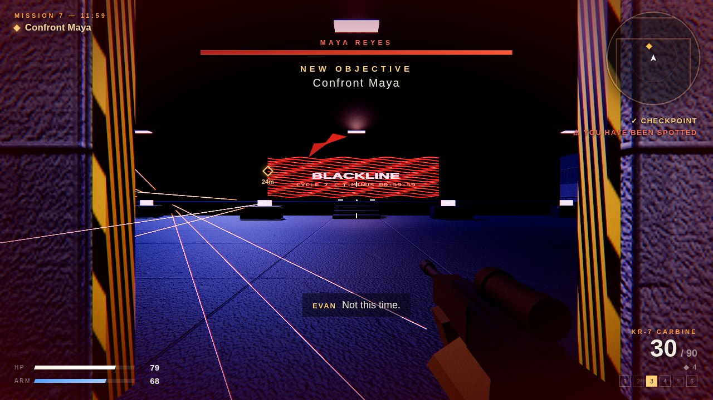

# BLACKLINE: LAST HOUR



**A cinematic, story-driven first-person shooter that runs in your browser.** Seven chapters, three playable flashbacks, a betrayal at 3,000 feet, and a twist ending. Every model, texture, sound effect and music cue is generated in code, so there are no asset downloads and it works fully offline.

### ▶ [Play it in your browser](https://Shashankupadhyay2024.github.io/blackline-last-hour/) · [Download for Mac](https://github.com/Shashankupadhyay2024/blackline-last-hour/releases/latest)

*Desktop only: keyboard and mouse, or any Xbox/PlayStation controller. Chrome or Edge recommended.*

> The world was supposed to end at 11:59 PM. Nobody knew who set the clock.
> Evan Cross, a pilot turned mercenary, takes one last job: steal a briefcase from a convoy in the Nevada desert. Inside he finds a photograph of himself, taken tomorrow.

| | |
|---|---|
|  |  |
|  |  |
|  |  |

## Highlights

- **10 playable chapters:** desert stealth and a convoy ambush, an underground facility, a city under air attack, a jet dogfight, a tropical island, and a final assault on Blackline HQ
- **Playable flashbacks** where your former partner Maya fights beside you as an AI teammate
- **Story choices** that change the ending: spare or execute Silas Kade, trust or shoot Maya, go in loud or quiet
- **Fully voiced:** 275 lines of dialogue made with offline neural text-to-speech
- **Vehicles and aircraft:** pickup trucks, an armored SUV, an APC with an autocannon, and a flyable fighter jet with lock-on missiles
- **Enemy AI** that patrols, notices you gradually, takes cover, flanks, throws grenades and calls out to each other
- **HDR graphics** with bloom, tone mapping, sun shafts and per-chapter colour grading
- **Controller support** with aim assist and vibration, and **variable-zoom scopes**
- A hidden Easter egg, and a golden gun to go with it

## How it was built

I designed and directed this game, and built it with **Claude (Anthropic)** as an AI pair programmer. I wrote the story, chose the features, playtested every chapter and sent back what to fix. Claude wrote the code.

- **About 6,500 lines of JavaScript** on [Three.js](https://threejs.org), with no game engine
- **Procedural everything:** models, textures, terrain, music and sound effects are all generated in code
- **Voices:** [Piper](https://github.com/rhasspy/piper) neural TTS, rendered offline and embedded as Opus audio
- **One-file build:** `build.py` bundles everything into a single offline `index.html`
- **Automated testing:** [Playwright](https://playwright.dev) scripts play through all 10 chapters headlessly and die and respawn at every checkpoint to make sure nothing breaks
- **Mac app:** the same file wrapped in [Electron](https://www.electronjs.org)

## Chapters

| # | Chapter | What you do |
|---|---|---|
| 1 | **The Convoy** | Silas Kade hires you for "one last job". Stealth into a desert camp, ambush a convoy, survive an airstrike, car chase and bomber set piece, and recover the briefcase |
| F·I | **Flashback: Glass Harbor** *(17 years ago)* | Young Lieutenant Evan and Sergeant Maya, with Maya fighting beside you, raid a camp on Major Kade's orders to "rescue" Dr. Lena Voss, the woman who built the Blackline. Maya makes Evan promise to remind her if she ever forgets him |
| 2 | **Blackline** | Infiltrate the underground facility, hack the archive, find your own file, and escape the collapse. Kade cuts into the radio: "Ask her who signed that file" |
| F·II | **Flashback: The Safehouse** *(7 years ago)* | Kade sends Evan and Maya after Voss, who ran with a drive. She tells them what the Blackline really needs: a pilot on the switch. Kade's cleaners come for all three of you. Hold the house, run for the car, and live through the first time Maya takes Evan's memory to keep him alive |
| 3 | **Burn the City** | Armored SUV through a city under air attack, fight through the airport, take off in a fighter |
| 4 | **The Betrayal** | Fly on Silas Kade's wing through his beacons, dogfight, stop three bombers over the hospital district. Then Maya's gun on the back of your seat, and Kade's missile |
| 5 | **The Island** | Wash ashore unarmed, punch your way to a weapon, search the memory labs and the wall of photographs |
| F·III | **Flashback: The Last Good Day** *(3 years ago)* | The day before the seventh wipe. Steal the transmitter key, send the world the message *WHEN THE BLACKLINE OPENS, DO NOT TRUST THE SKY*, hold the tower, run for the boat, and find Kade waiting at the dock |
| 6 | **The Last Hour** | Find the Cycle Chamber, broadcast the archive, fight **Silas Kade** (boss), then choose: **spare or execute him**. Then choose how the final mission begins: **loud** (APC through the front gate) or **quiet** (by sea through the drainage tunnel) |
| 7 | **11:59** | Assault Blackline HQ, get through the laser corridor, destroy the cores, fight Maya, then choose: **trust her or shoot her**. Four endings depending on your Silas and Maya choices, and every one ends on "Evan... you're not the player." → **PLAYER 2 CONNECTED.** |

Also included: several **BOTTLE OF JACK** power-ups in every chapter, a hidden **fish-tank Easter egg** (Chapter 2) that unlocks the overpowered golden gun and the achievement **"IT'S LIT."**, fifteen achievements, chapter select, and checkpoints with save/continue.

---

## Story, flashbacks and choices

- **Flashbacks** play in a warm, faded look with a FLASHBACK tag at the top of the screen. Maya fights beside you as an AI teammate: she follows you, takes cover and shoots anything she can see, and her name floats over her head so you never lose her. Flashbacks start you with their own loadout, and your main-story arsenal is waiting when you return.
- **New character, Silas Kade:** the client in Chapter 1, the voice cutting into your radio, your wingman in Chapter 4, and the man behind every reset.
- **Choices carry forward:** sparing or executing Silas in Chapter 6 and trusting or shooting Maya in Chapter 7 decide which of four final scenes you get. The loud/quiet choice changes how Chapter 7 starts.

## Mac app

Download `BLACKLINE-mac.zip` from the [latest release](https://github.com/Shashankupadhyay2024/blackline-last-hour/releases/latest). It is a standalone app for Apple Silicon Macs (M1 and later). Install it with one command:

```bash
cd ~/Downloads && ditto -xk BLACKLINE-mac.zip . && xattr -cr BLACKLINE.app && codesign --force --deep --sign - BLACKLINE.app && rm -rf /Applications/BLACKLINE.app && mv BLACKLINE.app /Applications/ && open /Applications/BLACKLINE.app
```

The app isn't from the App Store, so `xattr` and `codesign` tell macOS you trust it. It opens fullscreen: **Cmd+Ctrl+F** toggles fullscreen and **Cmd+Q** quits. To build the app yourself, run `bash mac/build-mac-app.sh` on a Mac.

## 1. What needs to be installed

**To play:** a modern desktop browser (Chrome, Edge, Firefox or Safari, 2022 or later) on a computer with a GPU. `docs/index.html` is the whole game in one self-contained file.

**To modify and rebuild:** Python 3.8+.
**To run the automated test:** `pip install playwright && python3 -m playwright install chromium`

## 2. Install dependencies

There is nothing to install to play. Three.js r149 is already vendored in `vendor/three.min.js`.

## 3. Start the game

```bash
cd blackline-last-hour && python3 -m http.server 8000 --directory docs
```
Then open http://localhost:8000. On Chrome or Edge you can also just double-click `docs/index.html`.

Chapters load as separate page visits (`index.html?m=1` … `?m=10`; flashbacks are 2, 4 and 8), so each world stays fast. **CONTINUE** and **CHAPTER SELECT** handle this for you.

## 4. Stop the game

Close the tab. If you used the local server, press **Ctrl + C** in its terminal.
Progress saves at every checkpoint (browser localStorage), and finishing a chapter unlocks the next.

## 5. Controls

| Key | Action |
|---|---|
| W A S D · Mouse | Move · look/aim |
| Left / Right click | Fire · aim down sights (sniper scope) |
| R · Shift · C/Ctrl · Space | Reload · sprint · crouch · jump / handbrake |
| E | Interact, pick up, enter/exit vehicles, close terminal text |
| G | Grenade |
| 1–7 / wheel / Q | Switch weapon (7 = golden pistol once found) |
| V | Vehicle camera distance |
| Esc / P | Pause |
| Space / Enter | Skip cinematic |
| **Unarmed** | Left click punches. Punching an unaware enemy is a silent takedown |
| **Jet** | Mouse = pitch/roll · W/S throttle · Shift boost · A/D yaw · LMB cannon · hold the nose on a target until the box turns red, then RMB fires a missile |

## Controller

Any Xbox, PlayStation or standard Bluetooth/USB controller works. Connect it, press any button, and prompts switch to controller buttons automatically. Menus are fully navigable (D-pad/stick, A to select, B to go back).

| Button | On foot | Driving | Jet |
|---|---|---|---|
| L-stick / R-stick | Move / look (with aim assist) | Steer / camera | Pitch & roll |
| LT / RT | Aim or scope / fire | Brake-reverse / gas | Throttle down / up |
| A / ✕ | Jump | Handbrake | Cannon |
| B / ○ | Crouch (toggle), back | — | Missile |
| X / □ | Interact / reload | Exit | — |
| Y / △ | Next weapon | Exit | — |
| LB / RB | Previous weapon / grenade | Camera distance / shoot | Yaw |
| L3 / R3 | Sprint (hold L3 while scoped: steady breath) / melee | — | Boost |
| D-pad | ↑↓ scope zoom · → swap rifle optic · ← golden pistol | | |

Controller settings: look sensitivity, aim assist, vibration, and toggle or hold aiming.

## Scopes

- **Pistol / shotgun:** iron sights. **SMG:** red dot. **Rifle:** a **3x scope** by default; press **T** / D-pad → to swap to the holo sight.
- **Sniper:** a 4x–10x variable scope (mouse wheel or D-pad ↑↓). It sways with your breathing; hold **Shift** (or L3) to steady it for a few seconds. The breath meter is shown under the scope.
- Everything outside the lens is blurred and darkened.

## Damage rules

- **Headshots kill instantly** with every gun (Maya excepted: she takes extra headshot damage instead).
- **Rockets and grenades** kill every enemy inside a large blast radius in one hit. Keep your distance, because they still hurt you.
- **Golden gun:** fully automatic, 999 damage per shot, pinpoint accurate, and it hits Maya almost three times harder than anything else.
- **Sniper rifles** turn up in every chapter.

## Easter egg (spoiler)

In Chapter 2, take the side corridor off the east hallway that leads to the server hall. Shoot the loose vent grate at its dead end, then crouch (C) through the crawlspace. Shoot Scotty's fish tank. The lights go out, a wall panel opens, and the golden gun is yours from then on.

## What carries between chapters

Every weapon, all your ammo and your grenades carry into the next chapter. In Chapter 4 you wash ashore empty-handed, but your gear washes up too: pick up the first weapon on the beach and your whole arsenal comes back. **New Game** starts fresh; **Chapter Select** keeps what you're carrying.

## Voices

Maya, Evan, Silas Kade and Dr. Lena Voss are fully voiced (275 lines), and enemies shout call-outs in combat: "Contact!", "Reloading!", "Grenade!", "Man down!". The voices are neural text-to-speech generated offline with [Piper](https://github.com/rhasspy/piper) and built into the game, so they need no internet. Maya's radio lines get a radio filter, and the music dips while someone talks. Settings has **Character voices** on/off and **Voice volume**.
Voice models: Lessac (Maya) and Ryan (Evan) are licensed for non-commercial use only, and LibriTTS (Silas, Voss and the enemies) is CC BY 4.0. To regenerate the voices after editing dialogue, run `python3 tools/make_voices.py`.

## Graphics

The game has an HDR pipeline: MSAA, bloom on lights, fire and muzzle flashes, ACES tone mapping, per-chapter colour grading, film grain, vignette, animated clouds, and chromatic aberration when you're hurt. The pipeline also adds volumetric sun shafts, lens dirt that catches bright lights, anamorphic light streaks, subtle sharpening, and relief detail on terrain, walls and floors. Settings → Quality goes up to **Ultra** (4K shadow maps, full Retina resolution). Turn **Post-processing** off on older machines.

## 6. Systems

- **Weapons:** pistol, SMG, assault rifle, shotgun, scoped sniper, rocket launcher, grenades, fists, golden pistol. Recoil, spread, reload animations, tracers, casings, hit/headshot markers
- **Enemy AI:** rifle, shotgun flanker, heavy, laser-sighted sniper, plus Blackline operatives. They patrol, notice you gradually (`?` → `!`), take cover, flank, search, dodge grenades, and use waypoint navigation indoors
- **Vehicles:** pickup, technical, armored SUV, traffic cars, APC with autocannon, a flyable fighter jet. AI chase vehicles and lane-following traffic
- **Air:** jets, bombers with carpet-bombing lines, gunship and dropship helicopters, dogfighting interceptors with lock-on missiles
- **Stealth and security:** sweeping security cameras, laser tripwires, alarms that wake turrets and alert every guard
- **Set pieces:** building collapses, a collapsing facility on a countdown, a slow-motion bomber hit, cinematic cameras
- **Graphics:** dynamic sun and shadows, sky-based environment lighting, nearest-light pooling for indoor and street lights, fog, particles, fire, smoke, explosions, decals, debris, water, screen shake
- **Audio:** synthesized WebAudio with 3D positioning, plus a procedural score that intensifies in combat

## 7. Project structure

```
blackline-last-hour/
├── docs/index.html          ← THE GAME (single offline file, served by GitHub Pages)
├── mac/                     Electron wrapper + build-mac-app.sh
├── screenshots/
├── src/
│   ├── index.template.html  HUD, menus, CSS
│   ├── core.js              renderer, collision, ray casting, textures, settings
│   ├── fx.js                particles, tracers, decals, lights, audio + music
│   ├── models.js            procedural models: weapons, soldiers, vehicles, aircraft, helis, turret, fish…
│   ├── world.js             sky, lighting, terrain, desert world
│   ├── builders.js          walls/doors/rooms, light panels, indoor nav graph, extra textures
│   ├── entities.js          enemies, cars, aircraft, projectiles, props, pickups, explosions
│   ├── entities2.js         helis, turrets, cameras, doors, tripwires, civilians, collapses, jet flight model, dogfight AI
│   ├── player.js            movement, weapons, driving, power-up
│   ├── hud.js               HUD, radar, jet HUD, boss bar, cinematic camera
│   ├── mission.js           mission framework, checkpoints, achievements, countdowns
│   ├── story.js             Maya as an AI teammate, Silas Kade boss, story choices
│   ├── m1.js … m5.js, m3b.js chapters 1–7 (world, spawns, objectives, dialogue, set pieces)
│   ├── f1.js f2.js f3.js    the three playable flashbacks
│   └── main.js              game loop, menus, chapter flow, intro/ending
├── vendor/three.min.js      Three.js r149 (MIT)
├── build.py                 bundles src/ + vendor/ → docs/index.html
├── tools/make_voices.py     regenerates src/voicepack.js (Piper TTS)
├── tests/smoke.py           headless playthrough of all ten chapters
└── tests/respawn.py         dies and respawns at every checkpoint of every chapter
```

## 8. Where the assets are

There are no asset files. Textures are generated in `core.js` and `builders.js`, models in `models.js` (and the chapter files), and sound in `fx.js`.

## 9. How to modify the game

1. Edit files in `src/`.
2. Run `python3 build.py`.
3. Reload the browser.
4. Optional: run `python3 tests/smoke.py`.

Common tweaks:
- **Weapons:** the `WDEF` table in `player.js`
- **Enemy stats:** the `ETYPES` table in `entities.js`
- **A chapter's objectives, spawns and dialogue:** the `steps`, `reset()` and `LINES` blocks in that chapter's `m*.js`
- **Rename the Easter-egg fish:** `EGG_NAME` in `m2.js`
- **Add a chapter:** copy an `m*.js`, register `LEVELS[11]`, add it to `CHAPTERS` in `mission.js` and to `ORDER` in `build.py`, and raise `LAST_CH`

**Dev hook:** the browser console exposes `__BL`. For example, `__BL.cp(2)` jumps to checkpoint 2 and `__BL.go(4)` loads Chapter 4.

## Settings

Quality, effects, shadows, anti-aliasing, fullscreen, FOV, sensitivity, invert Y, and master/music volume. All persist between sessions.

## Credits and licenses

- Game design, story and direction: Shashank Upadhyay. Code: written with Claude (Anthropic).
- [Three.js](https://threejs.org) r149, MIT license.
- Voices: Piper models *Lessac* (Maya) and *Ryan* (Evan) are licensed for non-commercial use only; *LibriTTS* (Silas, Voss, enemies) is CC BY 4.0. This is a free, non-commercial project.
- All characters, places and organizations are fictional.
